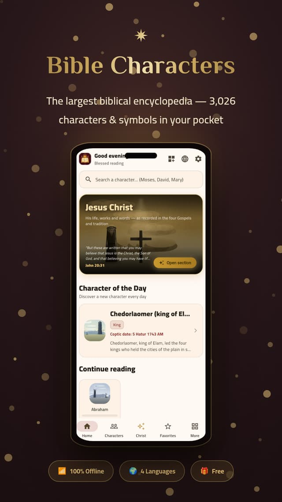
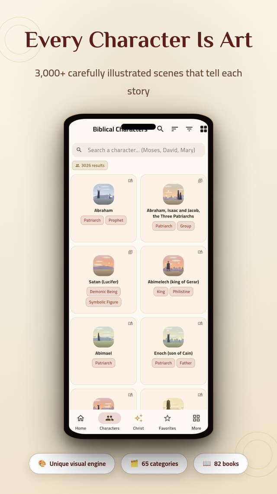
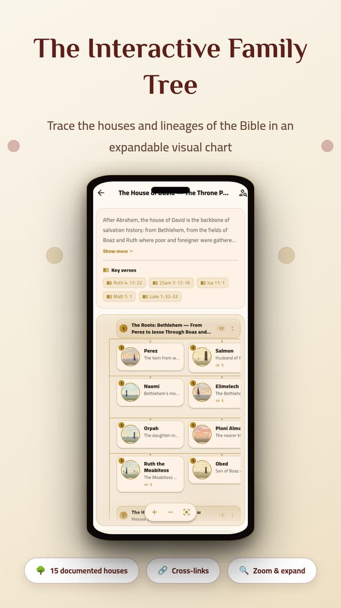
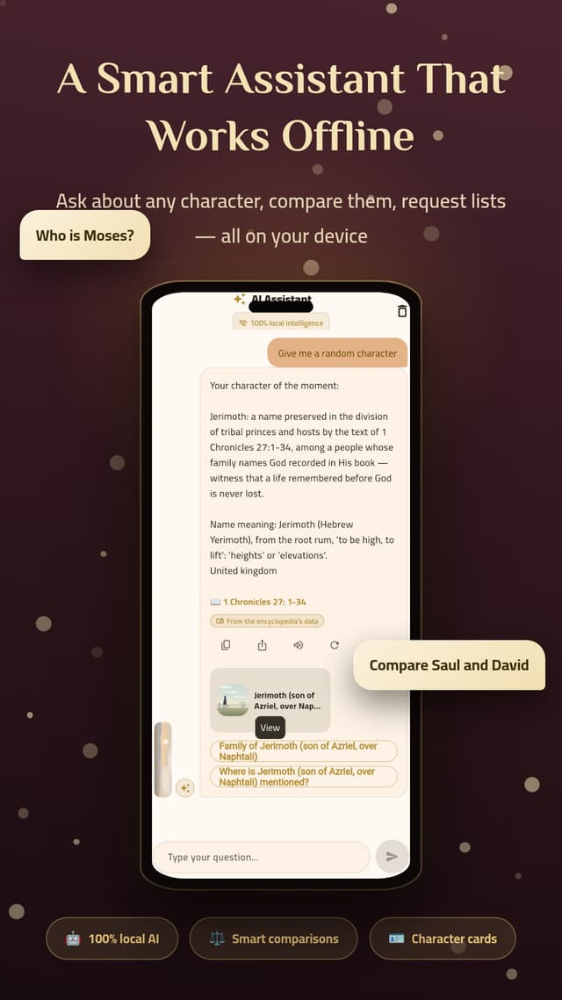
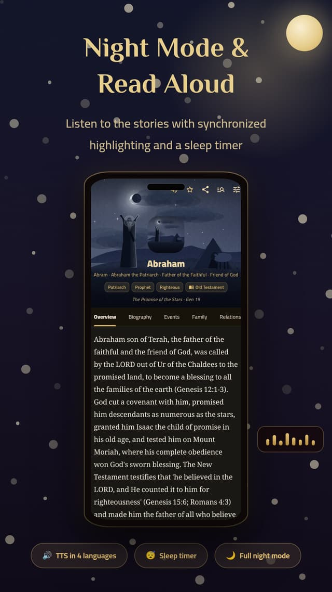

# ✝️ Bible Characters Encyclopedia

**Every person in the Bible — their complete, documented story.**

3,026 characters & symbols · 4 languages · 100% offline

---

### A whole scriptural library, in your pocket

From Adam in Eden to the last page of Revelation — **3,026 characters and symbols**, each with a fully documented profile: identity, lineage and era, the events that shaped them, the lessons they carry, and the legacy they left. Every event is cited by book, chapter and verse.

No connection required. Ever.

---

## ✨ Inside the app

<table>
<tr>
<td width="50%" valign="top">

**📖 A complete encyclopedia**
The largest collection of Bible characters ever assembled in one app — Old Testament, New Testament, the Twelve, the Seventy, the women of the Bible, and the unnamed men and women whose stories still speak.

**🎙️ Synchronized text-to-speech**
Listen with word-by-word highlighting, a floating player, adjustable speed and pitch, male or female voices, and a sleep timer. Close your eyes and let the story carry you.

**🌳 The interactive family tree**
15 documented houses, 307 members, up to 9 generations — from Adam's house to David's and the Holy Family, with connecting lines and detail cards.

**🎨 A unique scene engine**
Every character and symbol receives its own carefully composed illustration, plus hundreds of hand-curated scenes: the Ark, the Crossing, Daniel's den, the Nativity.

**🤖 A local AI assistant**
Ask *"who is…?"*, compare two characters, or list the kings and prophets. It answers from the database itself — on the device, without a connection.

**🔍 Instant smart search**
A living index of 83,000+ entries: names, epithets, descriptions and categories, filtered as you type — with full Arabic diacritic support.

</td>
<td width="50%" valign="top">

**🕊️ The complete Christ section**
23 documented parts, from prophecy to the Second Coming: the incarnation, the journeys, the miracles and parables, the seven sayings from the cross, Passion Week, the resurrection and the ascension.

**🔥 The symbols module**
103 symbols in 8 groups — Revelation and heaven, Christ and the Church, the gods of the nations, the spirits of darkness — each with its theological meaning.

**📅 Character of the Day**
A Coptic calendar with Synaxarium feasts and a gentle daily reminder: a new life to meet every morning.

**🗂️ Organization without equal**
65 categories, 15 time periods, and ready-made indexes: apostles, disciples, women, the unnamed, biblical order, chronological order, by book and by category.

**🎧 Your personal library**
Favorites, bookmarks, folders, tags and notes — with undo and one-file backup & restore across devices.

**🌙 Made for reading**
11 themes, 10 embedded Arabic fonts, a strict night mode, and a distraction-free focus view. Read the way your eyes love.

</td>
</tr>
</table>

---

## 📱 A look inside

---

## 🌍 Four languages, one tap

| Language | Direction | Typography |
|---|---|---|
| العربية | Full RTL | Amiri (headings) + Readex Pro (text) |
| English | LTR | Readex Pro |
| Français | LTR | Readex Pro |
| Español | LTR | Readex Pro |

Every screen, every profile, every citation — instantly translated, with the interface direction following the language.

---

## 🔢 Numbers that are real

| 3,026 | 82 | 65 | 103 | 23 |
|:---:|:---:|:---:|:---:|:---:|
| characters & symbols | documented books | categories | biblical symbols | parts on Christ |

*Every figure is drawn from the app's actual database — not an estimate.*

---

## 🎬 Try it before you install

The live page is **not a gallery of screenshots**. It is a miniature edition of the app running on a real sample of the database: search for *Moses*, *David* or *Ruth*, filter by testament and category, and open a full profile — right in the browser, in all four languages.

---

## 📥 Get the app

**App Store — coming soon.**

---

Built with **Next.js 16**, **React 19**, **TypeScript** and **Tailwind CSS 4** — and a great deal of care.

Designed & developed by **[Beshoy Nabil](https://github.com/good-man-developer)** · Published by **Coptic Koogi**

*“† Glory be to God forever. Amen. †”*

MIT licensed · Free to use and adapt

